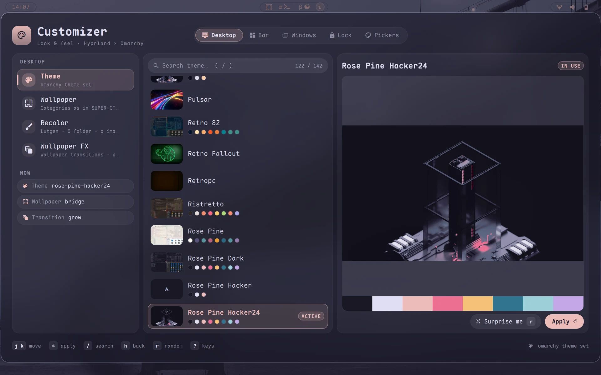
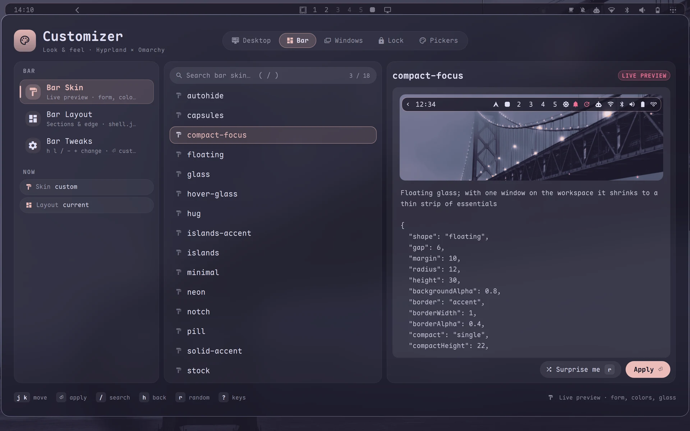
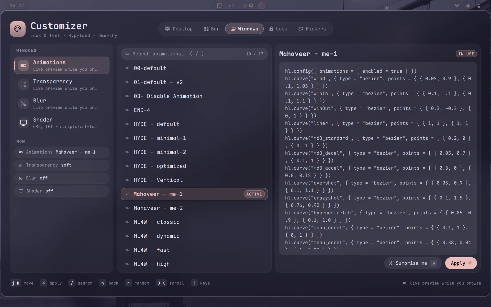
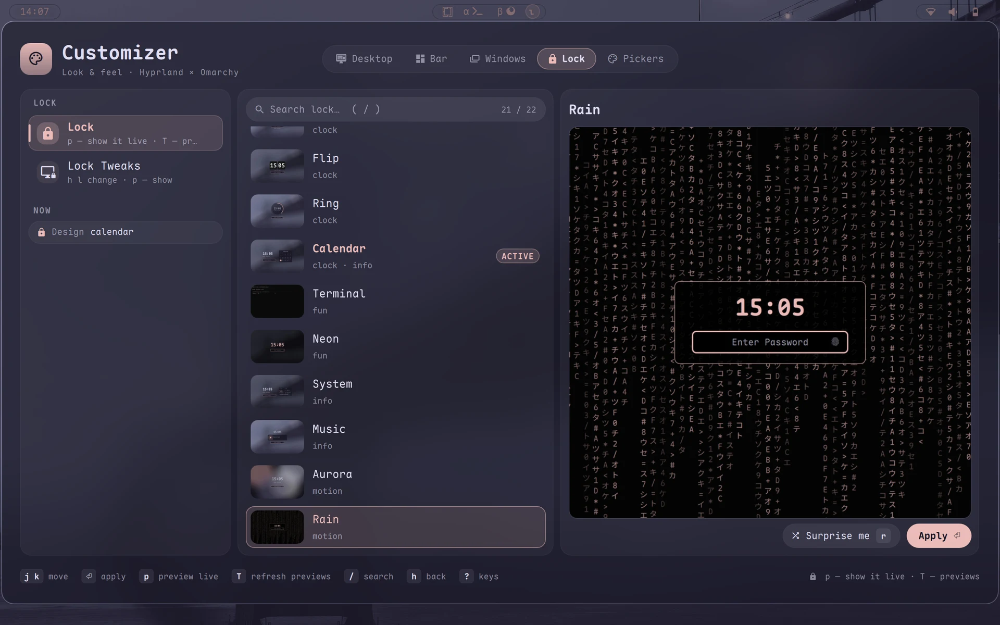
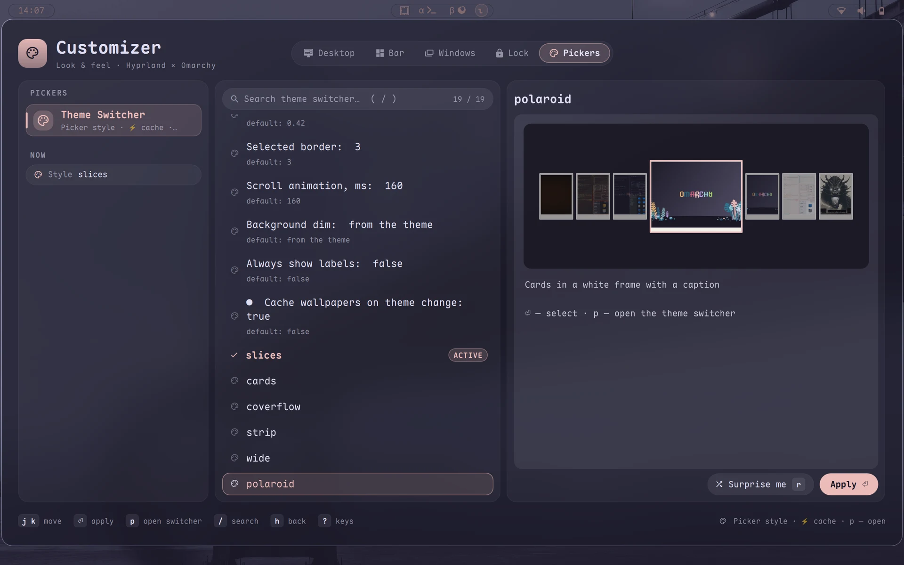

# Omarchy Customizer

[🇬🇧 English](README.md)

Один оверлей для всего оформления [Omarchy](https://omarchy.org): темы, обои, анимации Hyprland,
прозрачность, блюр и шейдеры экрана — с живым предпросмотром при листании. Если стоят плагины-компаньоны,
он же настраивает бар, экран блокировки, переходы обоев и стиль пикера.



| Группа | Что внутри |
|---|---|
| **Рабочий стол** | Тема (палитра + превью), Обои (категории как в переключателе обоев), Recolor (перекраска любой картинки в цвета темы через lutgen), Wallpaper FX* |
| **Бар*** | Bar Skin, Bar Layout, Bar Tweaks — 41 параметр, у каждого виден дефолт и живой предпросмотр |
| **Окна** | Анимации (17 пресетов), Прозрачность, Блюр, Шейдер (CRT / TFT) — всё вживую при листании |
| **Блокировка*** | Дизайн экрана блокировки с превью в цветах темы, Lock Tweaks |
| **Пикеры*** | Стиль пикера тем / обоев, кэш миниатюр |

\* появляется, только если стоит соответствующий плагин-компаньон — см. ниже.

| Бар | Окна |
| :---: | :---: |
|  |  |
| **Блокировка** | **Пикеры** |
|  |  |

## Установка

Customizer и вопрос про каждый плагин-компаньон:

```sh
curl -fsSL https://raw.githubusercontent.com/KamradSmeshnyavy/omarchy-customizer/main/install.sh | bash
```

`… | bash -s -- --all` — со всеми компаньонами, `--with bar,lock` — только с перечисленными, `--none` —
только Customizer. Скрипт ставит каждый плагин через `omarchy plugin add`, добавляет бинд **Super+Shift+T** в
`~/.config/hypr/bindings.lua` и перезапускает шелл.

Вручную:

```sh
omarchy plugin add https://github.com/KamradSmeshnyavy/omarchy-customizer --enable
omarchy restart shell
```

и бинд в `~/.config/hypr/bindings.lua`:

```lua
o.bind("SUPER + SHIFT + T", "Omarchy Customizer", "omarchy-shell shell toggle kamradsmeshnyavy.customizer")
```

Проверено на Omarchy 4.0.6 и Quickshell 0.3.2.

### Плагины-компаньоны

Каждый — отдельный плагин; Customizer находит их сам.

| Плагин | Что добавляет в Customizer |
|---|---|
| [omarchy-bar-skins](https://github.com/KamradSmeshnyavy/omarchy-bar-skins) | группа **Бар**: 19 скинов, 9 раскладок, compact, стили workspaces |
| [omarchy-lock-designs](https://github.com/KamradSmeshnyavy/omarchy-lock-designs) | группа **Блокировка**: 21 дизайн |
| [omarchy-wallpaper-fx](https://github.com/KamradSmeshnyavy/omarchy-wallpaper-fx) | **Wallpaper FX**: 24 перехода с превью |
| [omarchy-image-picker-styles](https://github.com/KamradSmeshnyavy/omarchy-image-picker-styles) | группа **Пикеры**: шесть стилей |
| [omarchy-launcher-skins](https://github.com/KamradSmeshnyavy/omarchy-launcher-skins) | полноэкранные скины лаунчера (настраиваются своим файлом) |

### Необязательные программы

- `libvips` — быстрые миниатюры тем и обоев (`omarchy pkg add libvips`)
- `zenity` — диалоги выбора цвета, текста и файла в твиках
- плагин `kamradsmeshnyavy.widgets` — категория **Виджеты** на Рабочем столе (часы, сейчас играет, визуализатор cava, кольца системы)
- `lutgen` — Recolor (виден, только когда есть и lutgen, и zenity)
- `omarchy-wallpaper-theme` в `PATH` + `matugen` — строки «🎨 Тема из обоев» в **Теме**: тема `dynamic` в стиле Material You из текущих обоев ([скрипт](https://github.com/KamradSmeshnyavy/dotfiles/blob/main/omarchy-themes/scripts/omarchy-wallpaper-theme))

## Клавиши

| Клавиши | |
|---|---|
| Tab / 1–5 | группы |
| j k · l ⏎ · h | вверх-вниз · открыть · назад |
| / | поиск |
| h l, − + | изменить твик · x — сбросить |
| p | проиграть / показать вживую (переходы, дизайны lock, пикер) |
| r | случайный выбор |
| ? · q / Esc | все клавиши · закрыть |

## Как выбор переживает перезагрузку

Пресет анимаций хранится в `~/.local/state/omarchy-customizer/animations.lua`; прозрачность, блюр и шейдер —
в `~/.local/state/hypr/{opacity,blur,screen-shader}`. Customizer применяет их при старте шелла и после
каждого `hyprctl reload`. Чтобы при перезагрузке конфига не мелькали даже на миг дефолты, подключи хук в
конфиге Hyprland (например, в конце `~/.config/hypr/looknfeel.lua`):

```lua
dofile(os.getenv("HOME") .. "/.config/omarchy/plugins/kamradsmeshnyavy.customizer/hypr/customizer.lua")
```

Скрипты работают и сами по себе — их можно повесить на клавиши:

```lua
o.bind("SUPER + ALT + O", "Next transparency preset", "~/.config/omarchy/plugins/kamradsmeshnyavy.customizer/scripts/opacity.sh next")
o.bind("SUPER + ALT + U", "Next blur preset", "~/.config/omarchy/plugins/kamradsmeshnyavy.customizer/scripts/blur.sh next")
o.bind("SUPER + ALT + C", "Toggle screen shader", "~/.config/omarchy/plugins/kamradsmeshnyavy.customizer/scripts/crt-toggle.sh")
```

## Свои пресеты

- Анимации: `~/.config/omarchy/customizer/animations/*.lua` (Lua Hyprland: `hl.curve`, `hl.animation`).
  Файл с тем же именем, что у встроенного, заменяет его.
- Шейдеры: `~/.config/omarchy/customizer/shaders/*.frag`. Шейдеру с `time` автоматически ставится
  `damage_tracking = 0`, искажающему — `1`.

## Язык

Английский и русский. Язык берётся из `"lang"` в `~/.config/omarchy/customizer.json`, иначе из `$LANG`
(`ru*` → русский). Переводы — `i18n/<язык>.json`, ключ — английская строка: новый язык — ещё один файл.

## Лицензия

GPL-3.0 — см. [LICENSE](LICENSE) и [NOTICE](NOTICE). Пресеты анимаций — из
[HyDE](https://github.com/HyDE-Project/HyDE), [ML4W](https://github.com/mylinuxforwork/dotfiles) и
[end-4](https://github.com/end-4/dots-hyprland) ([авторы](animations/CREDITS.md)); оверлей сделан в стиле
собственных плагинов шелла [Omarchy](https://github.com/basecamp/omarchy) (MIT).

Часть [моих dotfiles](https://github.com/KamradSmeshnyavy/dotfiles).
